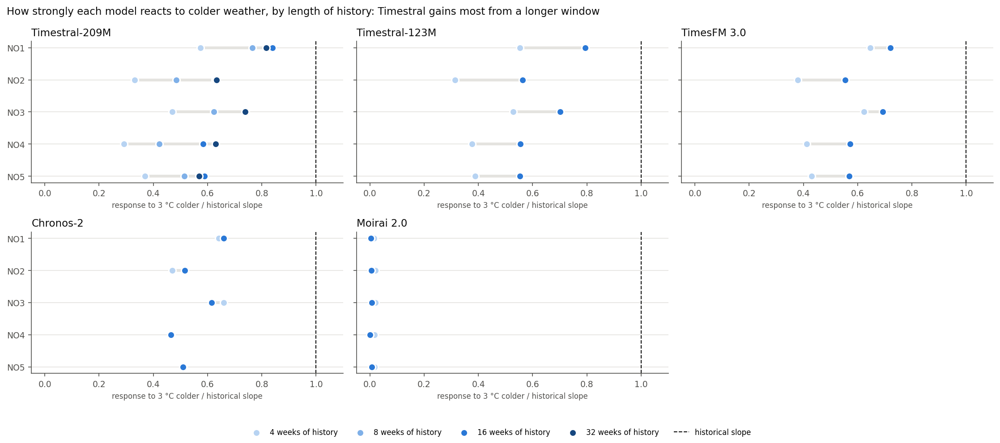
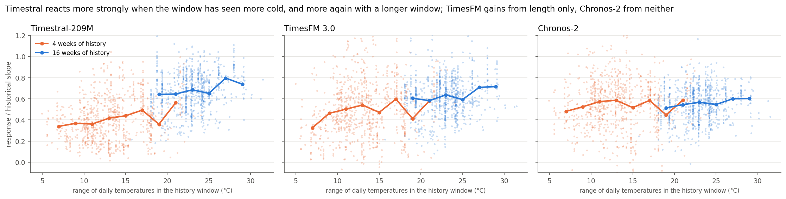
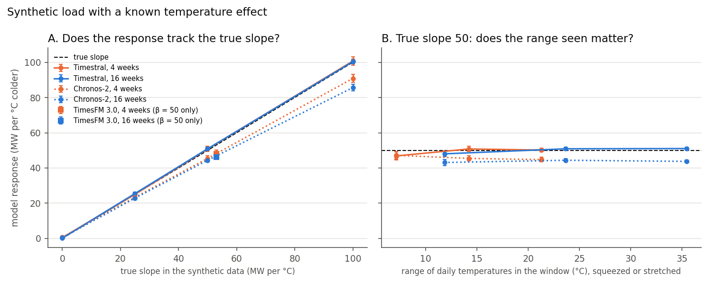
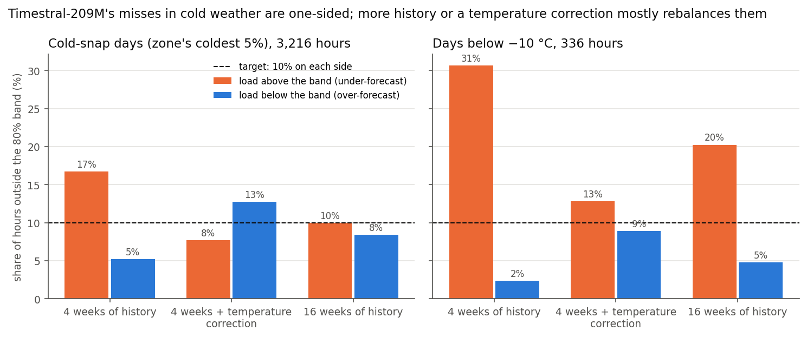
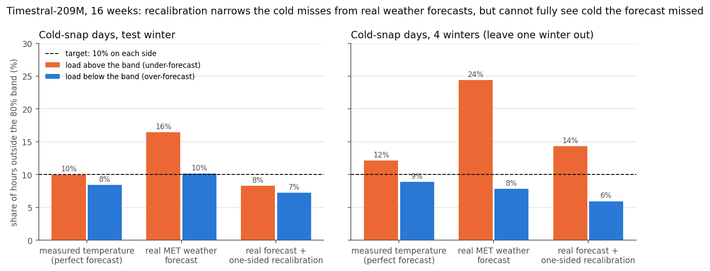

# Timestral on Norwegian electricity load

I tested Mistral's Timestral, a zero-shot time-series foundation model released on 15 Oct 2026, on day-ahead hourly electricity load in Norway's five bidding zones (NO1-NO5), against three other foundation models (Chronos-2, TimesFM 3.0 and Moirai 2.0), two simpler baselines, and the day-ahead forecast that Statnett, the Norwegian transmission system operator, publishes. The question was whether a grid operator could rely on it, especially in cold snaps: does it make use of temperature without any training on this data, and are its uncertainty bands calibrated?



*The probe: the same test-winter forecasts, rerun with every future temperature 3 °C colder. Each dot is the change in the median forecast divided by the zone's historical load-temperature slope (1.0 means the model reacts as strongly as history says load does). Timestral's response grows from 4 to 8 to 16 weeks of history and then levels off at 32 (mean 0.41, 0.56, 0.68, 0.68). The smaller Timestral-123M shows the same pattern. TimesFM 3.0's response grows less (0.50 to 0.62), Chronos-2's barely moves, and Moirai 2.0 doesn't react to temperature at all.*

## Main findings

1. Timestral learns how strongly cold drives load from the history window it is given. With 4 weeks of history its response to colder weather is about 40% weaker than with 16 weeks (the same pattern on a second winter), and its under-forecast appears on exactly the days that are colder than anything in the window (bias 0, +46 and +76 MW as the cold gets newer). Chronos-2's response hardly depends on history length, and TimesFM 3.0 sits in between. On synthetic load with a known temperature slope, Timestral recovers the slope almost exactly even from 4 weeks. The real-data pattern comes back when load follows temperature with a delay, as it does when buildings cool slowly: Timestral then reaches half the correct response with 4 weeks and all of it with 16, while Chronos-2 doesn't change. TimesFM 3.0 handles the delay from 4 weeks already, so the delay explains Timestral's dependence on history but not TimesFM's smaller one. None of the synthetic features I tested reproduces TimesFM's pattern.
2. With 4 weeks of history, the cold-snap misses are one-sided. Overall coverage of the 80% band looks fine (0.79), but on days below -10 °C the load was above the band 31% of the time and below it 2%, where a calibrated band misses 10% on each side. Chronos-2 fails the same way (28% above).
3. Two fixes work. Giving the model 16 weeks of history lowers its MAE by 12-17% in each of five winters and balances the cold-snap misses. Recalibrating each end of the band separately, per temperature bin, brings the cold-snap misses to about 10% above and 10% below over five winters, for Timestral, Chronos-2 and TimesFM 3.0. Standard conformalized quantile regression (CQR) doesn't, because it widens both sides of the band when the problem is on one side.
4. With real weather forecasts the second fix only partly holds. Using archived MET Nordic forecasts instead of observed temperature, Timestral's error rises from 70 to 77 MW (cold snaps 69 to 86 MW) and its bands become too narrow (coverage 0.76). Recalibrating on earlier real-forecast runs restores 80% coverage overall. Over four winters, though, the load was still above the recalibrated band on 14% of cold-snap hours (24% without it, target 10%) and on 19% [13, 27] of hours below -10 °C. On cold days the weather forecast was 1-2 °C too mild, and a correction keyed to the forecast temperature can't see cold that the forecast didn't predict. This is the main open problem.
5. With 16 weeks of history, Timestral was the most accurate model I tested. Temperature cuts the error of every model that can use it, Timestral's by 39% (-44 MW [-52, -37]). Timestral had a lower error than Chronos-2 (by 5-12%) and TimesFM 3.0 (by 5-8%) in all five winters, and also with real weather forecasts in the four winters that have them, with every paired interval excluding zero. It also beat a LightGBM baseline. With only 4 weeks of history the three foundation models are statistically tied in every winter, so the lead comes from how much Timestral gains from the longer window. With measured temperature, the 80% bands of Timestral and TimesFM are calibrated and Chronos-2's are too narrow. Moirai 2.0 could not make use of temperature at all.
6. With real weather forecasts, Timestral was also more accurate than the day-ahead forecast Statnett publishes on the ENTSO-E Transparency Platform, in all four winters (77 against 128 MW in the test winter). That holds over the five zones, not in each: in NO1, the largest zone, Statnett's forecast was better in the three earlier winters. It is also the published forecast, which may not be the one Statnett operates on. For an operator, covering the daily peak on 9 days in 10 takes about 700 MW of margin above Timestral's forecast with real weather forecasts (five zones summed), against about 750 MW for TimesFM 3.0, 900 MW for Chronos-2 and 1,000 MW for Statnett's published forecast.

## What this does and does not show

| Claim | Evidence | Limits |
|---|---|---|
| Timestral's temperature sensitivity is set by its context window, more than TimesFM 3.0's and unlike Chronos-2's | Counterfactual probe (3 °C colder), all 5 zones, replicated on a second winter; bias by how new the cold is to the window, over 5 winters; synthetic load with a known slope, which Timestral, Chronos-2 and TimesFM 3.0 (one slope only) all recover from context | Probe on two winters; the historical slope is a daily long-run figure, so ratios below 1 are not errors in themselves; the synthetic tests show a delayed temperature effect is enough to produce Timestral's pattern, not that it is the only cause, and none of the tested features explains TimesFM's smaller effect |
| The cold-snap misses are one-sided and come from short history | 4 vs 16 weeks, paired, in every winter; same pattern in Chronos-2, milder in TimesFM 3.0 | Deep-cold evidence rests on few days (14 zone-days below -10 °C in the test winter) |
| One-sided temperature-bin recalibration fixes the cold bands | Fitted on earlier winters only; leave-one-winter-out over 5 winters | A standard tool (CQR, Romano et al. 2019) applied per group and per side, not a new method. With real weather forecasts it works only partly: 14% above vs 6% below the band over four winters |
| Timestral is the most accurate model tested, given 16 weeks of history, and more accurate than Statnett's published day-ahead forecast | Paired: 5 winters vs Chronos-2 and TimesFM 3.0; real-forecast runs in 4 winters, scored on the same hours as Statnett's forecast | One country; Moirai 2.0 could not use temperature; Statnett may operate on a different forecast than the one it publishes, and in NO1 its published forecast was better in three of the four winters; LightGBM not tuned |

The study started with 4 weeks of history. In that setting the model looks well calibrated overall while failing one-sidedly in the cold, which only shows up when the misses are split by regime and by side. I kept the 4-week results as the diagnosis. The main finding is that the context length sets how strongly Timestral responds to a covariate (less so for TimesFM 3.0, hardly at all for Chronos-2). The rest shows how to detect the resulting failure and how to fix it.

## Data

| | Source | Notes |
|---|---|---|
| Load | [Elhub](https://api.elhub.no) open API, `CONSUMPTION_PER_GROUP_MBA_HOUR` | Hourly metered consumption per price area, sum of all consumption groups (excludes grid losses). 2021-01 to 2026-03, 0 missing hours. Used instead of ENTSO-E because the ENTSO-E API token arrived only after the study. |
| Temperature | [MET Norway Frost API](https://frost.met.no) | One station per zone: NO1 Oslo-Blindern (SN18700), NO2 Kristiansand-Kjevik (SN39040), NO3 Trondheim-Voll (SN68860), NO4 Tromsø (SN90450), NO5 Bergen-Florida (SN50540). Kjevik replaced Sømskleiva, which had 14% interpolated values. |
| Temperature, several stations (robustness check) | MET Norway Frost API | 3-5 stations per zone, population-weighted (section 7). |
| Statnett's day-ahead load forecast (benchmark) | [ENTSO-E Transparency Platform](https://transparency.entsoe.eu) via `entsoe-py`: day-ahead total load forecast and actual total load per bidding zone | The forecast Statnett publishes by 10:00 CET the day before. It targets total load, which includes grid losses, so I scale it to Elhub's level (section 6). Hourly until 18 Mar 2025 and 15-minute after, averaged to hours. 0 missing hours in the study period. |
| Weather forecasts | [MET Nordic forecast archive](https://github.com/metno/NWPdocs/wiki/MET-Nordic-dataset) | The 06 UTC run of the day before (available at the noon decision), nearest 1 km grid cell to each station. The archive has no runs from 12 UTC on 16 Mar to 06 UTC on 18 Mar 2026, so those 2 test days are dropped from every real-forecast comparison (likewise 8 Feb 2024, whose run was incomplete). |

All timestamps are UTC. Each target day is the 24 UTC hours from local midnight. On the 23-hour spring DST day the window ends at 00:00 local the next day, so every forecast has the same shape.

## Setup

- Task: day-ahead, 24 hours, one forecast per zone and day. The main forecast origin is 12:00 local time the day before (lead 12-35 h), which matches day-ahead bidding. A midnight origin (lead 0-23 h) is the secondary comparison.
- Periods: test winter 2025-26 (1 Nov to 31 Mar) and calibration winter 2024-25, plus 2022-23 and 2023-24 for the 3-winter calibration and robustness checks. I added 2021-22 late, as a robustness winter only: it is never used for the main fit or the test-winter results, and appears only in the five-winter checks. Nothing is fitted on the test winter.
- Models, producing the quantiles 0.05, 0.10, 0.50, 0.90 and 0.95 unless noted:
  - Seasonal naive: same hour last week, with empirical residual quantiles. The floor any model has to beat.
  - LightGBM quantile regression on lagged load, calendar and temperature, trained on data before each winter, with common hand-set hyperparameters (400 trees, learning rate 0.05; not tuned). A standard weather-aware machine-learning baseline of the kind used in practice.
  - Timestral-209M (Oct 2026), zero-shot: the model under test.
  - Chronos-2 (Oct 2025), zero-shot: the main comparison. It is a strong open foundation model that takes known future covariates natively, and it was released before the test winter, so it also serves as a clean control for possible contamination.
  - For Timestral and Chronos-2, temperature enters as a past and future covariate through each model's documented interface.
  - Statnett's day-ahead forecast, as published on the ENTSO-E Transparency Platform: the professional benchmark. It is a point forecast, so only its accuracy is compared (section 6).
  - TimesFM 3.0 (Google) and Moirai 2.0 small (Salesforce, Aug 2025), zero-shot, two other widely used open foundation model families with a covariate input, added after the main study to check whether the context effect is specific to Timestral. TimesFM then got the main runs Timestral and Chronos-2 have (all five winters at 4 and 16 weeks, the probe on two winters, real weather forecasts, several stations), but not the noisy-temperature, holiday-flag, 32-week or midnight-origin runs; Moirai 2.0 ran on the test and calibration winters (section 6). TimesFM takes temperature through its documented past-and-future covariate input. Moirai 2.0's documentation doesn't mention covariates; its code accepts them as extra variates, which is what I used. Both predict only the deciles 0.1-0.9, so their 90% band and pinball loss are not reported, and both have non-commercial weight licences.
- Context length: 16 weeks (2,688 h) in the main setting, chosen on the calibration winter (section 3). 4 weeks (672 h) was the original setting and is kept as the diagnosis.
- Regimes, with thresholds from history before the test winter:
  - Cold snap: days below the zone's 5th percentile of daily mean temperature. The test winter has 29-41 such days per zone, the calibration winter only 7-23.
  - Peak: hours above the zone's 95th load percentile (reporting only). Any correction that conditions on peak uses an ex-ante version.
  - Holiday: 24 Dec-1 Jan, Easter and public holidays.
- Metrics: MAE, MAPE, MASE, pinball loss (the proper score for quantiles), 80%/90% coverage and width, and one-sided miss rates (share of hours above q0.90 or below q0.10, target 10% each).
- Confidence intervals, in brackets: day-level block bootstrap with 1,000 resamples. Paired comparisons resample the same days for both models.

## Results

All numbers are for the test winter 2025-26 at the noon-before origin, with observed temperature, unless stated otherwise. Full tables are in `results/tables/` (suffix `_noon_before_ctx2688` = main setting, `_ctx672` = 4 weeks).

### 1. Timestral learns the temperature effect from its history window

#### The probe

I forecast the test winter a second time with every future temperature 3 °C colder (past unchanged) and measured the change in the median forecast, in MW per °C. The ratio is the model's response divided by the historical slope of daily load on daily temperature (2021 to Oct 2025, with weekday and month effects).

| | NO1 | NO2 | NO3 | NO4 | NO5 | Mean [95% CI] |
|---|---:|---:|---:|---:|---:|---:|
| Historical slope (MW/°C) | -123 | -55 | -35 | -29 | -29 | |
| Timestral, 4 weeks | 0.57 | 0.33 | 0.47 | 0.29 | 0.37 | 0.41 [0.39, 0.42] |
| Timestral, 8 weeks | 0.76 | 0.48 | 0.62 | 0.42 | 0.51 | 0.56 [0.55, 0.58] |
| Timestral, 16 weeks | 0.84 | 0.63 | 0.74 | 0.58 | 0.59 | 0.68 [0.66, 0.69] |
| Timestral, 32 weeks | 0.82 | 0.63 | 0.74 | 0.63 | 0.57 | 0.68 [0.66, 0.69] |
| Timestral-123M, 4 weeks | 0.55 | 0.31 | 0.53 | 0.38 | 0.39 | 0.43 [0.41, 0.45] |
| Timestral-123M, 16 weeks | 0.79 | 0.56 | 0.70 | 0.56 | 0.55 | 0.63 [0.62, 0.65] |
| Chronos-2, 4 weeks | 0.64 | 0.47 | 0.66 | 0.47 | 0.51 | 0.55 [0.53, 0.57] |
| Chronos-2, 16 weeks | 0.66 | 0.52 | 0.61 | 0.47 | 0.51 | 0.55 [0.54, 0.57] |
| TimesFM 3.0, 4 weeks | 0.65 | 0.38 | 0.62 | 0.41 | 0.43 | 0.50 [0.47, 0.52] |
| TimesFM 3.0, 16 weeks | 0.72 | 0.55 | 0.69 | 0.57 | 0.57 | 0.62 [0.61, 0.64] |
| Moirai 2.0, 4 weeks | 0.02 | 0.02 | 0.02 | 0.02 | 0.02 | 0.02 [0.02, 0.02] |
| Moirai 2.0, 16 weeks | 0.00 | 0.01 | 0.01 | 0.00 | 0.01 | 0.00 [0.00, 0.01] |

With 4 weeks Timestral reacts weakly. The response rises with 8 and 16 weeks (to 1.5-2× the 4-week value; mean change from 4 to 16 weeks +0.27 [0.26, 0.28]) and doesn't rise further at 32 weeks, the same point where accuracy stops improving (section 3). Timestral-123M behaves the same way (mean 0.43 at 4 weeks, 0.63 at 16), so this looks like a property of the model family rather than of one checkpoint. Chronos-2 hardly changes (+0.00 [-0.01, +0.02]). TimesFM 3.0 sits in between: its mean response rises from 0.50 to 0.62 (+0.12 [0.11, 0.14]). Moirai 2.0 doesn't respond at all (section 6). The window-range regression and the synthetic tests at β = 50 below (clean, slow drift, Christmas dip, delayed effect, one station) include TimesFM 3.0 as well; the other slopes and the squeezed or stretched range cover Timestral and Chronos-2 only.

The intervals come from the day-level bootstrap (`probe_summary`), and the differences between models and history lengths are much larger than them.

A day-ahead model that sees a sudden 3 °C drop only in the future can reasonably react less than the long-run slope, since buildings cool slowly, so a ratio below 1 is not wrong in itself. The comparison across window lengths and models is the part I rely on.

#### Does it replicate? A second winter

I reran the probe on the calibration winter 2024-25 (`run_probe.sh`, second block, and `run_timesfm.sh`):

| Mean probe ratio [95% CI] | 4 weeks | 16 weeks | Change, 4 → 16 weeks |
|---|---|---|---|
| Timestral, test winter 2025-26 | 0.41 [0.39, 0.42] | 0.68 [0.66, 0.69] | +0.27 [0.26, 0.28] |
| Timestral, calibration winter 2024-25 | 0.50 [0.48, 0.51] | 0.69 [0.68, 0.71] | +0.20 [0.19, 0.21] |
| Chronos-2, test winter 2025-26 | 0.55 [0.53, 0.57] | 0.55 [0.54, 0.57] | +0.00 [-0.01, +0.02] |
| Chronos-2, calibration winter 2024-25 | 0.61 [0.59, 0.62] | 0.61 [0.60, 0.63] | +0.01 [-0.00, +0.02] |
| TimesFM 3.0, test winter 2025-26 | 0.50 [0.47, 0.52] | 0.62 [0.61, 0.64] | +0.12 [+0.11, +0.14] |
| TimesFM 3.0, calibration winter 2024-25 | 0.60 [0.58, 0.62] | 0.68 [0.67, 0.70] | +0.08 [+0.07, +0.09] |

The pattern holds. Timestral's response rises clearly with 16 weeks in both winters and Chronos-2's doesn't, and the two cross the same way: Chronos-2 reacts more strongly with 4 weeks, Timestral with 16. Timestral's gain is smaller in the calibration winter because its 4-week response starts higher there; the 16-week level is almost the same. TimesFM 3.0 again sits in between, with a smaller gain than Timestral in both winters (+0.08 and +0.12).

#### Window length or the cold it contains?

A longer window also contains a wider range of temperatures. To separate the two, I labelled each zone and forecast with the range of daily temperatures in its window (plan fixed before looking at the results; TimesFM 3.0 was added later with the same specification). A 4-week window in January can span 20 °C, one in November 8 °C.



| 16-week effect on the ratio (regression on zone effects + …) | 16 weeks only | + window temperature range | + target day temperature |
|---|---|---|---|
| Timestral | +0.27 [0.26, 0.28] | +0.23 [0.19, 0.26] | +0.19 [0.16, 0.23] |
| TimesFM 3.0 | +0.12 [0.11, 0.14] | +0.10 [0.06, 0.14] | +0.09 [0.05, 0.13] |
| Chronos-2 | +0.00 [-0.01, +0.02] | +0.04 [-0.00, +0.08] | +0.02 [-0.02, +0.06] |

Both matter for Timestral. Within 4-week windows its response rises with the cold the window has seen, from 0.36 when the range is below 10 °C to 0.56 at 20-24 °C (window-range coefficient +0.005 [0.001, 0.008] per °C, +0.008 [0.005, 0.011] with target-day temperature). But at the same range (16-20 °C), 16-week windows still respond about 45% more strongly (0.64 vs 0.44), so the range explains under a third of the length effect. TimesFM 3.0 shows a length effect of about half the size that the range doesn't explain either (at a range of 16-20 °C, 0.61 with 16 weeks vs 0.53 with 4), and no clear effect of the range itself (+0.002 [-0.002, +0.007] per °C). Chronos-2 shows neither effect.

#### Where the error appears

I labelled each zone-day in the four main winters by whether it is colder than every day in the model's history window (Timestral + temp).

| Target day | Zone-days | Bias, 4 weeks | Bias, 16 weeks | MAE change, 4 → 16 weeks |
|---|---:|---:|---:|---|
| A day as cold is in the last 4 weeks | 2,753 | 0 MW | -4 MW | -14% (-11 MW [-12, -9]) |
| Colder than the last 4 weeks, not the last 16 | 59 | +46 MW | -10 MW | -14% (-14 MW [-27, -0]) |
| Colder than the last 16 weeks too | 214 | +76 MW | +29 MW | -25% (-26 MW [-34, -19]) |

With 4 weeks, the under-forecast appears exactly when the cold is new to the window. 16 weeks removes it where the longer window has seen such cold, and cuts it by more than half where it hasn't. Adding 2021-22 (5 winters) gives the same picture: the bias on days new to both windows falls from +74 to +25 MW.

#### Synthetic load with a known slope

To check the mechanism where the answer is known, I built synthetic load as a daily and weekly profile plus β × (15 °C - T) plus noise, on real station temperatures. The model can then learn the true slope β only from the history window (`src/synthetic.py`, 45 forecasts per cell, plan fixed before running).



| Response / true slope | β = 25 | β = 50 | β = 100 | β = 50, window range squeezed ×0.5 / stretched ×1.5 |
|---|---:|---:|---:|---|
| Timestral, 4 weeks | 1.00 | 1.02 | 1.01 | 0.94 / 1.00 |
| Timestral, 16 weeks | 1.02 | 1.02 | 1.00 | 0.96 / 1.02 |
| Chronos-2, 4 weeks | 0.93 | 0.91 | 0.91 | 0.94 / 0.89 |
| Chronos-2, 16 weeks | 0.92 | 0.89 | 0.86 | 0.86 / 0.88 |

Both models learn the slope from the context. Timestral's response matches β almost exactly, while Chronos-2's runs about 10% low. Since β is only in the window, this is direct evidence that the covariate effect is learned in context. TimesFM 3.0, run on the β = 50 cell only, recovers 0.96 of the slope with 4 weeks and 0.92 with 16. On this clean data 4 weeks are enough, and the range of temperatures seen barely matters. The context dependence on real data must therefore come from something that real load has and this synthetic load lacks.

#### Adding real-data features to the synthetic load

I added one real-data feature at a time, at β = 50, without telling the model about it (each plan fixed before running). The first two candidates were slow level changes unrelated to temperature (a daily AR(1), sd 100 MW), and a 10% load dip on 24 Dec-1 Jan, which is cold and low-load at the same time and so pulls the apparent slope toward zero.

| Response / true slope | Clean | + slow drift | + Christmas dip | Christmas dip, windows containing it |
|---|---:|---:|---:|---:|
| Timestral, 4 weeks | 1.02 | 1.01 | 1.00 | 1.00 (15 windows) |
| Timestral, 16 weeks | 1.02 | 1.01 | 1.01 | 1.01 (33) |
| Chronos-2, 4 weeks | 0.91 | 0.89 | 0.87 | 0.76 [0.66, 0.85] (15) |
| Chronos-2, 16 weeks | 0.89 | 0.84 | 0.85 | 0.83 (33) |
| TimesFM 3.0, 4 weeks | 0.96 | 0.95 | 0.96 | 0.96 (15) |
| TimesFM 3.0, 16 weeks | 0.92 | 0.91 | 0.89 | 0.88 (33) |

Neither explains it. Timestral separates the slope from both, even in 4-week windows that contain Christmas. It is Chronos-2 that a short window with Christmas throws off. TimesFM 3.0 isn't thrown off either, and with either feature its response falls slightly from 4 to 16 weeks (drift -0.04 [-0.09, +0.01], Christmas dip -0.06 [-0.11, -0.01]), the opposite of its rise on real data.

Two more candidates:
- A delayed effect: load follows temperature smoothed over about a day (exponential, 24 h time constant), while the model sees hourly temperature. A sustained 3 °C drop then reaches only 39% of its full effect within the forecast day, so the correct response is 0.39 β and the ratio is taken against that.
- One station for the zone: load is built from the several-stations zone temperature (section 7), but the model only gets the single station.

| Response / correct response | 4 weeks | 16 weeks | Change, 4 → 16 weeks [95% CI] |
|---|---:|---:|---|
| Timestral, delayed effect | 0.51 | 1.03 | +0.52 [0.45, 0.60] |
| TimesFM 3.0, delayed effect | 1.00 | 0.99 | -0.01 [-0.09, +0.07] |
| Chronos-2, delayed effect | 0.92 | 0.89 | -0.03 [-0.08, +0.03] |
| Timestral, one station | 0.60 | 0.71 | +0.10 [0.07, 0.14] |
| TimesFM 3.0, one station | 0.67 | 0.64 | -0.03 [-0.08, +0.02] |
| Chronos-2, one station | 0.62 | 0.62 | 0.00 [-0.03, +0.03] |

The delayed effect reproduces Timestral's real-data pattern. With 4 weeks Timestral gets half the correct response and with 16 weeks all of it, in each of the three zones. Chronos-2 is unaffected by window length, and responds more strongly than Timestral at 4 weeks but less at 16, as in the real-data probe. My reading is that a slow response is harder to infer than an instant one, and Timestral needs more history to pin down the dynamics. TimesFM 3.0 gets the delayed effect right from 4 weeks (1.00), so this explains Timestral's dependence on history but not TimesFM's smaller one on real data. None of the four features tested here (slow drift, Christmas dip, delayed effect, one station) makes TimesFM's response rise with history, so its cause is still open.

Using one station lowers every model's response, most where the station tracks the zone worst (NO4, 0.35 for Timestral at 4 weeks). That is the usual effect of a noisy input. It adds only a little to the length effect, but it helps explain why the real ratios stay below 1.

The 24 h time constant is my assumption, and the test shows that a delayed effect is enough to produce the pattern, not that it is the cause in the real data. I did not test a relation that steepens in deep cold.

### 2. Short history: one-sided misses in cold snaps



*Share of cold-weather hours where the load fell above or below Timestral's 80% band. A calibrated band misses 10% on each side. The temperature correction is fitted on three earlier winters, never on the test winter.*

| Timestral + temp, 4 weeks | Bias (MW) | Above band | Below band |
|---|---:|---:|---:|
| All hours | +8 | 11.6% | 9.3% |
| Cold-snap days | +41 | 16.7% | 5.2% |
| Days below -10 °C (336 h) | +81 | 30.7% | 2.4% |

- Chronos-2 at 4 weeks has a cold bias of +36 MW, 19.9% above vs 7.3% below, and 28% above on days below -10 °C, so it shares the weakness. TimesFM 3.0 shows a milder version (cold bias +28 MW, 10.9% above vs 6.4% below).
- Cold-snap bias by zone (MW): NO1 +57, NO2 +63, NO3 +30, NO4 +35, NO5 +21. NO2 also has the weakest model response in the probe (0.33).
- The overall coverage of 0.79 hides all this. Averaged over all hours, the band looks calibrated.

### 3. First fix: more history

Change in MAE, 16 vs 4 weeks of history (paired, per winter). The context length was chosen on the calibration winter 2024-25.

| Winter | Timestral, all | Timestral, cold snaps | Chronos-2, all | TimesFM 3.0, all |
|---|---|---|---|---|
| 2022-23 | -13% [-9.4 MW: -12.0, -7.0] | -21% | -8% | -8% |
| 2023-24 | -17% [-13.1 MW: -16.6, -9.9] | -24% | -7% | -12% |
| **2024-25 (calibration)** | **-12% [-10.5 MW: -14.0, -7.3]** | **-22%** | **-5%** | **-11%** |
| 2025-26 (test) | -17% [-14.5 MW: -18.0, -11.6] | -23% | -8% | -12% |
| 2021-22 (robustness) | -14% [-9.8 MW: -12.5, -7.2] | -14% | -5% | -12% |

- With 16 weeks the cold-snap bias falls from +41 to +7 MW, and the cold-snap misses become 10.0% above and 8.4% below.
- TimesFM 3.0 gains in every winter too (8-12%), less than Timestral, and more than Chronos-2 in four of the five (about equal in 2022-23).
- 8 weeks (1,344 h) on the test winter: -13%.
- 32 weeks (5,376 h) gives no further gain. On the calibration winter it reaches -13.9% vs 4 weeks against -12.5% for 16 weeks (cold snaps -21% vs -22%), and on the test winter -17.0% against -17.2% (cold snaps -22% vs -23%), at about twice the CPU time (7.7-8.6 vs 3.6-3.7 s per forecast). Chronos-2 is slightly worse at 32 than at 16 weeks in both winters.
- 16 weeks costs 3.6 s instead of 1.4 s per forecast on a laptop CPU, which is nothing for one forecast per zone per day. Chronos-2's maximum context is 8,192 h, Timestral's 32,768 h.

### 4. Second fix: one-sided recalibration by temperature

CQR (Romano et al. 2019) and adaptive conformal inference (Gibbs & Candès 2021) restore overall coverage, but they widen both sides of the band, so the cold misses stay one-sided (table below, appendix D).

The fix calibrates each end of the 80% and 90% bands on its own (Q_hi from y - q0.90, Q_lo from q0.10 - y, each at the 90% level for the 80% band), separately per bin of day-mean temperature (below -10, -10 to -5, -5 to 0, and 0 °C or above). Bins with fewer than 240 calibration hours fall back to the pooled correction. It is fitted on 2022-25 and applied to the test winter, and also checked with leave-one-winter-out. Cold-snap days, share above / below the 80% band (target 10% / 10%):

| | No fix | CQR two-sided, temp bins | **CQR one-sided, temp bins** | One-sided, leave one winter out (4 / 5 winters) |
|---|---|---|---|---|
| Timestral, 4 weeks | 16.7% / 5.2% | 14.0% / 4.1% | **7.5% / 11.5%** | 10.2% / 9.6% · 10.2% / 9.5% |
| Chronos-2, 4 weeks | 19.9% / 7.3% | 14.6% / 5.4% | **7.8% / 10.2%** | 10.6% / 8.7% · 10.6% / 9.0% |
| Timestral, 16 weeks | 10.0% / 8.4% | 8.2% / 6.5% | **7.1% / 9.0%** | 9.6% / 9.7% · 9.4% / 10.1% |
| Chronos-2, 16 weeks | 18.8% / 7.9% | 12.7% / 5.0% | **7.8% / 10.1%** | 10.1% / 8.7% · 10.3% / 9.0% |
| TimesFM 3.0, 4 weeks | 10.9% / 6.4% | 11.5% / 6.7% | **7.6% / 10.5%** | 9.6% / 8.7% · 9.5% / 8.9% |
| TimesFM 3.0, 16 weeks | 7.3% / 4.8% | 6.8% / 4.5% | **5.5% / 5.9%** | 9.5% / 8.1% · 9.3% / 8.6% |

- Two-sided CQR per bin still leaves the misses lopsided. The one-sided version balances them and keeps overall coverage at 0.77-0.81.
- TimesFM 3.0 errs the other way at 16 weeks: in cold snaps its band is a little wide (7.3% above, 4.8% below), and the fit on 2022-25 leaves it wide on the test winter (5.5% / 5.9%). Over five left-out winters it lands at 9.3% / 8.6%.
- It doesn't move the median, so it fixes the bands but not the MAE. A two-parameter temperature bias correction does both (appendix C), but it needs a functional form (the 0 °C hinge).
- Below -10 °C on the test winter alone (14 zone-days) it doesn't help, because the fitting winters' deep-cold days were not under-forecast and there was nothing to learn. With leave-one-winter-out over 78 such zone-days (5 winters) it gives 9.2% above and 11.9% below (Timestral, 16 weeks).

### 5. Real weather forecasts

The main runs use observed temperature, which amounts to a perfect weather forecast. Here Timestral, Chronos-2 and TimesFM 3.0 get the forecast an operator actually has at noon the day before: the archived 06 UTC MET Nordic run (149 test days).

How wrong was the weather forecast? Error of the forecast day-mean temperature against the station:

| | Typical error (MAE), all days | Typical error, cold-snap days | Mean bias on cold-snap days |
|---|---|---|---|
| NO1 | 0.8 °C | 0.9 °C | +0.3 °C |
| NO2 | 0.9 °C | 1.3 °C | +1.2 °C |
| NO3 | 1.1 °C | 1.6 °C | 0.0 °C |
| NO4 | 1.0 °C | 1.1 °C | +0.2 °C |
| NO5 | 0.8 °C | 1.1 °C | +0.8 °C |

A positive bias means the forecast was milder than what happened, which pushes the load forecast down. On cold days the weather forecast is both less accurate and too mild.

What it costs:

| | MAE, observed → real forecast | Cold snaps | 80% coverage (all / cold) |
|---|---|---|---|
| Timestral | 69.8 → 76.5 MW (+9.5%, +6.6 MW [+3.9, +9.4] paired) | 68.8 → 86.4 MW (+25%) | 0.80 → 0.76 / 0.82 → 0.73 |
| Chronos-2 | 76.5 → 82.5 MW (+7.7%, +5.9 MW [+3.4, +8.6] paired) | 81.8 → 95.0 MW (+16%) | 0.75 → 0.70 / 0.73 → 0.67 |
| TimesFM 3.0 | 75.8 → 82.4 MW (+8.8%, +6.6 MW [+4.0, +9.7] paired) | 73.3 → 90.3 MW (+23%) | 0.81 → 0.78 / 0.88 → 0.81 |

Timestral with a real forecast is as accurate as Chronos-2 with a perfect one, and better than Chronos-2 and TimesFM 3.0 with the same real forecast. Its bands, however, become too narrow, since nothing in them accounts for the weather forecast being wrong. TimesFM's bands were a little wide with measured temperature and end up close to target (0.78).

#### Recalibrating on real-forecast runs

The recalibration has to be fitted on forecasts made with the weather forecast the operator will use, and binned by the forecast temperature, since the observed one is not known at noon the day before. I fitted it on the 2022-25 real-forecast runs and applied it to the test winter, and also ran leave-one-winter-out over all four real-forecast winters:



| Timestral, real MET forecast | 80% coverage | Above / below, cold snaps | Above / below, below -10 °C | Band width |
|---|---|---|---|---|
| Test winter, no fix | 0.76 | 16.4% / 10.2% | 28% / 7% | 218 MW |
| Test winter, one-sided, fit on 2022-25 | **0.81** | **8.3% / 7.2%** | 25% [7, 45] / 3% | 244 MW |
| 4 winters (leave one out), no fix | 0.75 | 24.4% / 7.9% | 29% / 9% | 214 MW |
| 4 winters (leave one out), one-sided | **0.80** | **14.3% [11, 17] / 5.9%** | 19% [13, 27] / 6% | 238 MW |

- On the test winter the fix works: coverage is back on target and the cold-snap misses are balanced, at the cost of bands about 12% wider.
- Over four winters it only partly works. It cuts the share of cold-snap hours above the band from 24% to 14%, not to 10%, and below -10 °C (74 zone-days) from 29% to 19%. Chronos-2 and TimesFM 3.0 are similar (cold snaps 31% to 13% and 21% to 14%). The temperature bias correction does no better (20% / 11%).
- The reason is that the weather forecast misses the cold. On cold-snap days the day-ahead forecast was 1.0-1.7 °C too mild in three of the four winters (0.5 °C in the test winter, which is why the test winter looks fixed), and 1.5-3.9 °C too mild on days below -10 °C. A correction chosen by forecast temperature can't see cold the weather forecast didn't predict.
- Two things might close the gap, neither tested here: correcting the weather forecast's cold bias before it enters the load model, or using ensemble weather forecasts so the bands carry weather uncertainty.

### 6. Comparison with the other models

All five zones, 18,120 hours (3,216 cold-snap hours), 16 weeks of history for the zero-shot models unless stated. Bias = actual minus median (positive = under-forecast). TimesFM 3.0 and Moirai 2.0 predict only the deciles, so they have no 90% band and no comparable pinball loss (n/a).

| Model | MAE (MW) | MAPE | Pinball | Cov 80% | Cov 90% | Cold-snap bias (MW) |
|---|---:|---:|---:|---:|---:|---:|
| Seasonal naive | 249.0 | 6.5% | 66.3 | 0.75 | 0.84 | +194 |
| LightGBM | 126.5 | 3.2% | 33.2 | 0.63 | 0.75 | +157 |
| LightGBM + temp | 97.0 | 2.6% | 27.0 | 0.53 | 0.67 | +62 |
| Chronos-2 | 117.9 | 3.0% | 29.2 | 0.75 | 0.87 | +78 |
| Chronos-2 + temp | 76.5 | 2.0% | 19.2 | 0.75 | 0.86 | +32 |
| Timestral | 114.1 | 2.9% | 28.2 | 0.77 | 0.88 | +73 |
| **Timestral + temp** | **69.8** | **1.9%** | **17.6** | **0.80** | **0.90** | **+7** |
| Timestral + temp, 4 weeks | 84.3 | 2.2% | 21.1 | 0.79 | 0.89 | +41 |
| TimesFM 3.0 | 118.4 | 3.1% | n/a | 0.79 | n/a | +79 |
| TimesFM 3.0 + temp | 75.8 | 2.0% | n/a | 0.81 | n/a | +13 |
| Moirai 2.0 | 128.0 | 3.3% | n/a | 0.71 | n/a | +111 |
| Moirai 2.0 + temp | 296.4 | 7.6% | n/a | 0.76 | n/a | +372 |
| Timestral + real MET forecast | 76.5 | 2.0% | 19.3 | 0.76 | 0.87 | +20 |
| Chronos-2 + real MET forecast | 82.5 | 2.2% | 21.1 | 0.70 | 0.83 | +48 |
| TimesFM 3.0 + real MET forecast | 82.4 | 2.1% | n/a | 0.78 | n/a | +28 |

Timestral vs Chronos-2, paired, 16 weeks, per winter:

| Winter | MAE, all hours | MAE, cold snaps |
|---|---|---|
| 2022-23 | -5.3% [-3.5 MW: -5.6, -1.6] | -3% [-2.2 MW: -7.9, +4.4] |
| 2023-24 | -12.3% [-9.2 MW: -11.8, -6.7] | -9% [-7.9 MW: -14.3, -1.3] |
| 2024-25 | -7.9% [-6.4 MW: -9.7, -3.4] | -10% [-8.0 MW: -15.8, +0.3] |
| 2025-26 (test) | -8.9% [-6.8 MW: -9.4, -4.0] | -16% [-13.0 MW: -20.0, -6.4] |
| 2021-22 | -9.1% [-5.9 MW: -8.4, -3.3] | -18% [-13.6 MW: -26.7, -2.4] |
| 2025-26, real MET forecast | -7.3% [-6.0 MW: -8.9, -3.3] | -9% [-8.7 MW: -17.8, +0.8] |

Timestral is better in every winter, and in every zone of the test winter. The overall difference is clear in each winter, the cold-snap difference in 3 of 5.

On cold-snap days, Timestral's upper band (q0.90) covers the actual peak-hour load on 89% of days (target 90%), against 93% for TimesFM 3.0 (a slightly wider band), 64% for Chronos-2 and 35% for LightGBM.

The reserve margin is the MW an operator would hold above the forecast daily peak to cover the actual peak on 9 days out of 10, summed over the five zones (`results/tables/reserve`):

| | Measured temperature | Real MET forecast |
|---|---:|---:|
| **Timestral, 16 weeks** | **609 MW** [523, 705] | **698 MW** [598, 839] |
| Chronos-2, 16 weeks | 805 MW [725, 894] | 908 MW [780, 1,021] |
| TimesFM 3.0, 16 weeks | 641 MW [563, 759] | 745 MW [666, 854] |
| Statnett's published forecast | | 1,030 MW [869, 1,235] |

TimesFM 3.0 needs a margin close to Timestral's, with measured temperature and with real forecasts: the intervals overlap.

#### Two more foundation models

I added Google's TimesFM 3.0 and Salesforce's Moirai 2.0 after the main study, with the same setup. Moirai 2.0 ran on the test winter (4 and 16 weeks with temperature, the 3 °C probe, and a load-only run) and the calibration winter (16 weeks). TimesFM 3.0 then got the main runs Timestral and Chronos-2 have: all five winters at 4 and 16 weeks, the probe on two winters, real MET forecasts and several stations (not the noisy-temperature, holiday-flag, 32-week or midnight-origin runs). Test winter, with temperature:

| | MAE, 4 weeks | MAE, 16 weeks | Change, 4 → 16 weeks | Cold-snap bias, 4 → 16 weeks | Probe response, 4 → 16 weeks |
|---|---:|---:|---:|---|---|
| Timestral-209M | 84.3 | 69.8 | -17% | +41 → +7 MW | 0.41 → 0.68 |
| TimesFM 3.0 | 86.0 | 75.8 | -12% | +28 → +13 MW | 0.50 → 0.62 |
| Chronos-2 | 83.4 | 76.5 | -8% | +36 → +32 MW | 0.55 → 0.55 |
| Moirai 2.0 | 178.0 | 296.4 | +67% | +162 → +372 MW | 0.02 → 0.00 |

- With 4 weeks of history, Timestral, TimesFM and Chronos-2 are statistically tied in every winter (table below; Chronos-2 minus Timestral between -0.9 and +2.0 MW, every interval including zero). With 16 weeks Timestral is ahead of TimesFM in all five winters, by 5-8%, and with real weather forecasts in all four that have them, by 4-7%. In cold snaps the gap is small and no interval excludes zero (test winter +4.4 MW [-2.2, +10.5]).

| TimesFM 3.0 minus Timestral, MAE (MW) [95% CI], positive = Timestral better | 4 weeks | 16 weeks | 16 weeks, real MET forecast |
|---|---|---|---|
| 2022-23 | -0.8 [-4.1, +2.2] | +3.0 [+1.2, +4.9] | +2.6 [+0.6, +4.6] |
| 2023-24 | +2.2 [-1.1, +5.3] | +5.9 [+3.7, +8.0] | +4.9 [+2.5, +7.2] |
| 2024-25 (calibration) | +3.3 [-0.1, +6.4] | +4.2 [+1.8, +6.7] | +3.1 [+0.6, +5.7] |
| 2025-26 (test) | +1.8 [-1.8, +5.0] | +6.0 [+3.8, +8.4] | +5.9 [+3.6, +8.5] |
| 2021-22 (robustness) | +1.9 [-1.0, +5.0] | +2.9 [+0.8, +5.1] | no forecast archive |

- TimesFM's 80% band is calibrated too (coverage 0.81 at 16 weeks; on cold-snap days 7.3% above and 4.8% below the band, so slightly wide).
- Without temperature, Moirai 2.0 is in the same range as the other models' load-only forecasts (128 MW against 114-118). Given temperature through its covariate input it gets much worse, and its forecast does not move when the future temperature changes. I found the same on synthetic load with a known slope. Its documentation does not claim covariate support, so I read this as an input that exists in the code but isn't usable, not as a verdict on Moirai's forecasting in general.
- The models differ in how much they learn the temperature effect from the history window: Timestral most, TimesFM less, Chronos-2 hardly at all. Timestral's lead depends on giving it the longer window.

#### Statnett's day-ahead forecast

Statnett, Norway's transmission system operator, publishes a day-ahead load forecast for each bidding zone on the ENTSO-E Transparency Platform, at the latest by 10:00 CET the day before. That is two hours before my forecasts are made, for the same day-ahead decision, and it is also made with real weather forecasts, so I compare it with the real-forecast runs. It forecasts total load, which includes grid losses, so I scaled it to Elhub's level with one factor per zone: Elhub over ENTSO-E actual load on the calibration winter (0.93-0.96). I fixed this method before looking at any result. Every model is scored on the same hours (`statnett_*` tables):

| MAE (MW), real weather forecasts | Statnett | Timestral | Timestral minus Statnett [95% CI] | Chronos-2 | TimesFM 3.0 |
|---|---:|---:|---|---:|---:|
| 2022-23 | 136.4 | 71.6 | -64.7 [-74.2, -56.3] | 74.9 | 74.2 |
| 2023-24 | 86.6 | 78.0 | -8.6 [-15.8, -2.0] | 86.1 | 82.8 |
| 2024-25 | 114.5 | 83.7 | -30.7 [-37.8, -23.3] | 88.9 | 86.9 |
| 2025-26 (test) | 128.3 | 76.5 | -51.7 [-61.2, -41.7] | 82.6 | 82.4 |
| All four, pooled | | | -38.9 [-43.5, -34.5] | | |

- Timestral was more accurate than Statnett's published forecast in all four winters, by 10-48%, and in cold snaps pooled over the four winters (-51.4 [-68.7, -35.2] MW), though not in the cold snaps of 2023-24 (+7.6 [-9.6, +28.7]). Chronos-2 and TimesFM 3.0 with the same weather forecasts also beat it, except in 2023-24, where the difference includes zero. In the test winter Statnett had the larger error in every zone.
- By zone the picture is mixed. In NO1, the largest zone, Statnett's forecast was better than every model here in the three earlier winters: MAE 72, 100 and 115 MW in 2022-23, 2023-24 and 2024-25, against 117, 144 and 147 MW for Timestral with real weather forecasts (92, 104 and 117 MW even with measured temperature). Only the test winter went the other way (188 against 130 MW). Statnett's larger overall error comes from big misses in other zones, for example NO2 and NO5 in 2022-23 (257 and 202 MW, against 98 and 40 MW for Timestral).
- It isn't a timing or level problem in the data. Moving Statnett's forecast by up to three hours lowers its error by at most 1.5 MW averaged over the zones (4.8 MW in the worst single case, NO4 in 2022-23), and removing each zone's average error per winter, which uses that winter's own actuals and so favours Statnett, leaves 78-136 MW (`statnett_checks`). Scored against its own target, ENTSO-E total load, its MAPE is 2.5-4.6%, against 2.0-2.3% for Timestral on Elhub. Where it does worst, the forecast doesn't follow the hourly pattern: for NO5 in 2022-23 its correlation with the actual load was 0.51.
- To cover the daily peak on 9 days in 10 in the test winter, Statnett's forecast needs 1,030 MW of margin [869, 1,235], against 698 MW for Timestral with real weather forecasts.
- What this doesn't show: this is the forecast Statnett publishes under EU transparency rules, and Statnett may operate on a different one. My models also see the load up to noon, which needs real-time measurements, while Statnett's forecast is due two hours earlier.

### 7. Robustness checks

#### A fifth winter (2021-22)

I added this winter late and use it only in the five-winter checks. Southern Norway (NO1, NO2, NO5) had record power prices from autumn 2021 and COVID measures until February 2022, so consumption likely sat below what the weather alone implies. The question is only whether the findings hold.

| 2021-22 | MAE | 80% coverage | Cold snaps: above / below the band |
|---|---:|---:|---|
| Timestral, 16 weeks | 59 MW | 0.80 | 6.6% / 11.2% |
| Chronos-2, 16 weeks | 65 MW | 0.75 | 16.7% / 8.7% |
| TimesFM 3.0, 16 weeks | 62 MW | 0.81 | 3.8% / 9.5% |
| Timestral, 4 weeks | 69 MW | 0.82 | 13.9% / 4.8% |

They do. Timestral is more accurate than TimesFM 3.0 and Chronos-2 and better calibrated than Chronos-2, 16 weeks beats 4, the cold misses at 4 weeks are one-sided (less so in this milder winter, with only 3 zone-days below -10 °C), and the one-sided recalibration is balanced over 5 winters (section 4).

#### Several weather stations per zone

Each zone also got a population-weighted temperature from 3-5 stations, one per main town (for NO2: Stavanger, Kristiansand, Arendal). The rule was fixed before any run: the nearest non-road station within 25 km with under 2% missing and under 2% gap-filled hours, weighted by rough regional population. Skien had no station passing the rule and was dropped, and two of the points are coastal lighthouses (`results/tables/stations_multi.csv`).

| 16 weeks | MAE, one station → several | Change [95% CI] | Cold snaps | 80% coverage |
|---|---|---|---|---|
| Timestral, test winter | 69.8 → 66.5 MW | -4.7% [-3.3 MW: -5.4, -1.5] | -6.0% [-4.1 MW: -9.9, +1.4] | 0.80 → 0.79 |
| Chronos-2, test winter | 76.5 → 73.9 MW | -3.4% [-2.6 MW: -4.5, -0.8] | -4.8% [-3.9 MW: -9.2, +0.8] | 0.75 → 0.74 |
| Timestral, calibration winter | 73.9 → 70.0 MW | -5.3% [-3.9 MW: -5.4, -2.2] | -1.6% [-1.2 MW: -7.1, +5.0] | 0.80 → 0.80 |
| Chronos-2, calibration winter | 80.2 → 75.7 MW | -5.6% [-4.5 MW: -6.3, -2.7] | -4.6% [-3.8 MW: -10.9, +3.8] | 0.77 → 0.77 |
| TimesFM 3.0, test winter | 75.8 → 72.7 MW | -4.1% [-3.1 MW: -4.9, -1.3] | -2.2% [-1.6 MW: -5.7, +2.4] | 0.81 → 0.82 |
| TimesFM 3.0, calibration winter | 78.1 → 74.7 MW | -4.3% [-3.3 MW: -5.2, -1.4] | -5.1% [-4.2 MW: -9.6, +3.2] | 0.81 → 0.81 |

The gain is small and consistent, 3-6% in both winters for all three models (in the test winter in every zone), and it changes no conclusion, so the main results stay on the single stations chosen at the start. The cold-snap gain is not significant in either winter.

## Appendix: secondary results

**A. Synthetic weather-forecast error** (one N(0, 1.5 °C) offset per zone-day). At 16 weeks it costs Timestral +15.3 MW [+11.7, +18.9] and drops coverage from 0.80 to 0.71. At 4 weeks it costs only +5.6 MW, so a model that leans harder on temperature is hurt more by a wrong one. Real forecasts cost less overall (+6.6 MW) but about as much in cold snaps (`covariates`).

**B. Daily peaks on cold-snap days (134 zone-days).** Share of days with the actual peak-hour load above q0.90 (target 10%): Timestral 16 weeks 11% [6, 17], 4 weeks 25%, Chronos-2 36%, LightGBM 65%, TimesFM 3.0 7% [3, 13]. Peak bias: +21, +62, +70, +102 and +19 MW. Timestral gets the peak hour right (within ±1 h) on 79% of days (`peaks`).

**C. Temperature bias correction.** Relative error of the median = a + b·max(0, 0 °C - T_day), fitted by least squares on earlier winters, with the shift applied to all quantiles.

| Test winter, 4 weeks, fitted on 2022-25 | Cold-snap bias | Cold-snap MAE | Above / below, cold | Above / below, below -10 °C |
|---|---:|---:|---|---|
| Timestral, no fix | +41 MW | 89.9 | 16.7% / 5.2% | 30.7% / 2.4% |
| Timestral + correction | -9 MW | 82.7 | 7.7% / 12.7% | 12.8% / 8.9% |
| Chronos-2, no fix | +36 MW | 89.5 | 19.9% / 7.3% | 28.3% / 10.1% |
| Chronos-2 + correction | -3 MW | 85.7 | 10.9% / 14.0% | 13.1% / 16.4% |

Fitting on the single mild calibration winter over-corrects (Timestral cold bias -43 MW), which is why the 3-winter fit became the main one. With leave-one-winter-out (4 winters, 395 cold zone-days), Timestral at 4 weeks goes from +53 to +3 MW (cold-snap MAE -8.1 MW [-13.6, -2.8]) and Chronos-2 at 4 weeks from +42 to +2 MW (-4.2 MW [-8.1, -0.0]). At 16 weeks Timestral's fitted slope is near zero, so there is nothing left to fix. The 5-winter version gives the same picture.

**D. Adaptive conformal inference** (daily updates, 2-day feedback delay). It gets overall 80% coverage right (Chronos-2, 4 weeks: 0.75 to 0.80), but in cold snaps the misses stay one-sided (Timestral, 4 weeks: 16% above, 5% below). At 16 weeks Timestral needs neither ACI nor CQR: static CQR moves its coverage from 0.795 to 0.798.

**E. Holidays.** Over Christmas and New Year the models over-forecast (Timestral, 16 weeks: bias -41 MW, coverage 0.65). A 0/1 holiday covariate doesn't help (4 weeks, 39 holiday days over 4 winters: +0.3 MW [-1.6, +2.4]). A shift by holiday type learned from other winters (Christmas, the days between Christmas and New Year (romjul), New Year, other) cuts the holiday error by about 10% (-9.6%, -10.0 MW [-20.8, +1.1]). With effectively four Christmases the interval includes zero, so this is suggestive but not established.

**F. Model size** (Timestral + temp, 4 weeks, test winter): 5M 108.9 MW, 28M 96.6, 123M 86.4, 209M 84.3, at 0.04, 0.18, 0.73 and 1.37 s of CPU per forecast. 123M gets almost all the accuracy at half the cost. At 16 weeks (test winter), 123M reaches 72.0 MW and 209M 69.8 MW (cold snaps 70.8 vs 68.8, coverage 0.78 vs 0.80).

**G. A simple ensemble doesn't help.** Averaging Timestral's and Chronos-2's quantiles beats Chronos-2 in every winter but not Timestral alone (+1.1 MW [-0.3, +2.4] on the test winter), and it brings back part of Chronos-2's cold bias.

## Decisions made after seeing test data

Some choices were made after I had looked at test-winter results:

1. The 0 °C hinge of the bias correction. I chose it from bias-versus-temperature plots that included the test winter. The parameters are fitted on calibration winters only.
2. The 3-winter calibration for the bias correction. It was planned as a sensitivity run and became the main calibration after the single mild calibration winter over-corrected on the test winter. Leave-one-winter-out is the check.
3. The temperature bins of the one-sided recalibration (-10, -5 and 0 °C). They are round numbers, but I picked them after seeing the bias-versus-temperature plots. Leave-one-winter-out is the check.
4. The 16-week context. I first noticed it on the test winter, in a sensitivity run. It became the main setting only after the 16-week runs on the calibration winter showed the same gain (-12% MAE). It holds in all 5 winters.
5. Keeping 2021-22 out of the main fit and the test-winter results, because it was added late and was an unusual winter.

## Limitations

- One test winter. Its cold snaps are one set of events. The leave-one-winter-out checks pool 4-5 winters but use the test winter as fitting data in most folds. The deep-cold results rest on few days.
- "Best" means best of the forecasts tested here: four foundation models, two baselines and Statnett's published day-ahead forecast. Moirai 2.0 ran on two winters only. There is no comparison with other foundation models (for example TiRex), a tuned LightGBM, a fine-tuned model, or the forecast Statnett operates on, if that differs from the published one.
- Weather. The main runs use observed station temperature, an oracle. The real-forecast runs use the nearest grid cell of one deterministic forecast per station, and only four winters have archived forecasts (2022-26).
- Station-based temperature. A population-weighted temperature from 3-5 stations lowers the error by 3-6% without changing any conclusion (section 7).
- The target is Elhub metered consumption, not ENTSO-E total load, so it excludes grid losses. Statnett's forecast targets total load, so I scaled it to Elhub's level (section 6).
- The models see the load up to the forecast origin. That assumes real-time load measurements, which a grid operator has; Elhub's metered data are not available that quickly.
- Possible contamination. The test winter predates Timestral's release and its training sources are not named, so it may have seen this data, which would favour Timestral. Three observations argue against memorisation driving the results:
  - The behaviour depends on the history window. With 4 weeks Timestral under-forecasts the test winter's cold snaps by +41 MW, with 16 weeks by +7 MW. A model recalling this winter would not need a longer window.
  - It reacts to temperatures it cannot have seen. In the probe the future temperature is 3 °C colder than what happened, and the forecast moves the right way by a plausible amount.
  - A clean model shows the same patterns. Chronos-2 (Oct 2025) cannot have seen the test winter and has the same one-sided cold misses at 4 weeks.

  TimesFM 3.0 (2026) may also have seen the test winter; Moirai 2.0 (Aug 2025) predates it. Contamination would mostly flatter the absolute accuracy of the models that may have seen the data. The findings about cold, history length and calibration rest on comparisons within the same model.
- The CPU timings are from one laptop, measured at different times, so treat them as rough.
- The conformal correction first took one order statistic too high, which made the bands very slightly too wide. The unit tests in `tests/` caught it, and after the fix every table was regenerated. Coverage and miss rates moved by at most 0.6 percentage points.

## Reproduce

```bash
pip install -r requirements.txt
cp .env.example .env              # add your Frost client ID (and an ENTSO-E token for the Statnett benchmark)
python -m src.data_load           # Elhub load
python -m src.data_weather        # Frost temperatures, one station per zone
python -m src.data_weather_multi  # several stations per zone (section 7)
python -m src.data_weather_forecast --winters w2025 w2024 w2023 w2022   # archived MET Nordic forecasts
python -m src.data_entsoe         # Statnett's day-ahead forecast and ENTSO-E actual load
# forecasts: the run scripts below, in order
python -m src.report --origin noon_before                   # 16 weeks (config default)
python -m src.report --origin noon_before --context 672     # 4 weeks
python -m src.report --origin midnight --context 672        # midnight origin
python -m src.headline            # figures
python -m src.synthetic --models timestral-209m chronos2 timesfm3 --confounders   # synthetic: slow drift, Christmas dip
python -m src.synthetic --models timestral-209m chronos2 timesfm3 --mechanism   # synthetic: delayed effect, one station
python -m src.synthetic --models timesfm3 --clean   # synthetic: TimesFM 3.0 on the clean beta = 50 cell
# (the basic synthetic runs, known slope and squeezed range, are in run_ctx32.sh)
python -m src.synthetic --report  # synthetic tables + figure
bash run_timesfm.sh               # TimesFM 3.0 (section 6)
# Moirai 2.0 needs torch<2.5, so it gets its own environment next to the repo:
#   python -m venv ../timestral-venv-moirai
#   ../timestral-venv-moirai/Scripts/python -m pip install -r requirements-moirai.txt
bash run_moirai.sh                # Moirai 2.0 (section 6)
python -m pytest tests -q         # conformal code with known answers, and leakage checks
```

The run scripts are the record of what was run, in this order. Each model and winter is cached to `results/cache/forecasts/`, and finished runs are skipped, so a script can be rerun safely.

| Script | Runs |
|---|---|
| `run_experiments.sh` | Midnight origin, 4 weeks: baselines, Timestral and Chronos-2, holiday flag, noisy temperature, model sizes |
| `run_noon.sh` | Main origin (noon the day before), 4 weeks: baselines, Timestral and Chronos-2, noisy temperature, extra winters, holiday flag |
| `run_overnight.sh` | Extra winters, noisy temperature, model sizes, 8/16-week sensitivity runs |
| `run_context.sh` | 16 weeks on the calibration winters (the context choice, made without the test winter) |
| `run_ctx16.sh` | Remaining 16-week runs for the main tables |
| `run_probe.sh` | The temperature probe (future 3 °C colder), 4 and 16 weeks |
| `run_ctx32.sh` | Real MET forecasts, 2021-22, several stations, synthetic probe, 32 weeks, probe at 8/32 weeks and for Timestral-123M |
| `run_timesfm.sh` | TimesFM 3.0: every winter at 4 and 16 weeks, probe on two winters, load only, real MET forecasts, several stations |
| `run_moirai.sh` | Moirai 2.0: 4 and 16 weeks, probe, load only, calibration winter |

Everything runs on CPU. Per forecast at 16 weeks: Timestral-209M 3.6 s, TimesFM 3.0 2.0 s, Chronos-2 1.1 s, Moirai 2.0 0.25 s. `results/README.md` lists which table and figure backs each section.

## Future work

- Fine-tune on Norwegian load, aimed at cold beyond anything in the history window.
- Use ensemble weather forecasts to carry weather uncertainty into the load bands.
- Test further foundation models (for example TiRex).
- Check the delayed-response explanation on real data, for example by giving the model a smoothed temperature as a second covariate and seeing whether the 4-week under-reaction disappears.
- Holidays: the 0/1 flag doesn't work zero-shot. A "same day last year" covariate might.

## References

- Mistral AI (2026). *Timestral* announcement, https://mistral.ai/news/timestral/, and model card, https://huggingface.co/mistralai/Timestral-209M.
- Ansari, A. F. et al. (2025). *Chronos-2: From Univariate to Universal Forecasting.* arXiv:2510.15821.
- Das, A., Kong, W., Sen, R., Zhou, Y. (2024). *A decoder-only foundation model for time-series forecasting.* ICML. arXiv:2310.10688. TimesFM 3.0 checkpoint: https://huggingface.co/google/timesfm-3.0-pytorch.
- Woo, G. et al. (2024). *Unified Training of Universal Time Series Forecasting Transformers.* ICML. arXiv:2402.02592. Moirai 2.0 checkpoint: https://huggingface.co/Salesforce/moirai-2.0-R-small.
- Meyer, M., Zapata Gonzalez, D., Kaltenpoth, S., Müller, O. (2024). *Benchmarking Time Series Foundation Models for Short-Term Household Electricity Load Forecasting.* arXiv:2410.09487.
- Lin, N., Yun, D., Xia, W., Palensky, P., Vergara, P. P. (2024). *Comparative Analysis of Zero-Shot Capability of Time-Series Foundation Models in Short-Term Load Prediction.* arXiv:2412.12834.
- Kaljevic, T., Arzola, I., Zhang, Y. (2026). *Benchmarking Time Series Foundation Models for Load Forecasting Under Covariate Uncertainty.* arXiv:2610.07232.
- Romano, Y., Patterson, E., Candès, E. (2019). *Conformalized Quantile Regression.* NeurIPS.
- Gibbs, I., Candès, E. (2021). *Adaptive Conformal Inference Under Distribution Shift.* NeurIPS.
